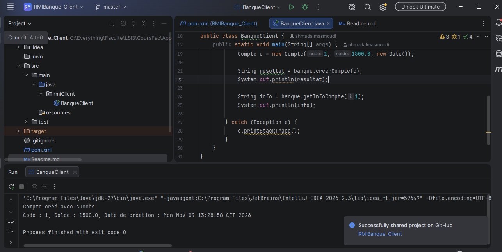
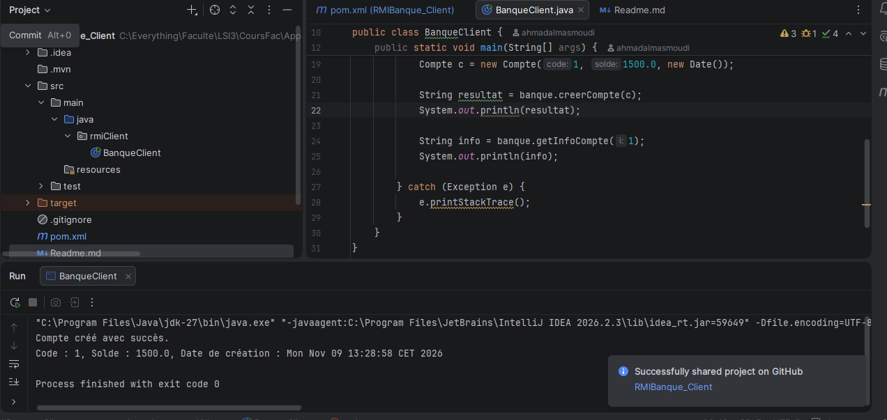

# TP 5 : Invocation des méthodes sur des objets distants avec Java RMI

**Nom :** Masmoudi
**Prénom :** Ahmed
## Activité 5-2 : Service de banque en utilisant RMI et JNDI

### Étape 2 : Développement du serveur

Dans cette étape, nous avons développé le serveur RMI de l'application bancaire. Nous avons créé la classe `Compte` (Serializable) pour représenter les comptes bancaires, l'interface distante `IBanque` définissant les opérations de création et de consultation des comptes, ainsi que la classe `BanqueImpl` qui implémente ces méthodes. Enfin, nous avons créé `BanqueServer` pour démarrer le registre RMI sur le port 1099 et publier le service bancaire sous le nom « Banque ».

### Étape 3 : Développement du client

Dans cette étape, nous avons créé le projet `RMIBanque_Client` et exporté l'interface `IBanque` ainsi que la classe `Compte` dans le fichier `banqueClient.jar`. Après avoir ajouté ce fichier au Classpath du projet client, nous avons développé la classe `BanqueClient` permettant de se connecter au registre RMI et d'invoquer à distance les méthodes de création et de consultation des comptes bancaires.

### Étape 4 : Exécution de l’application

